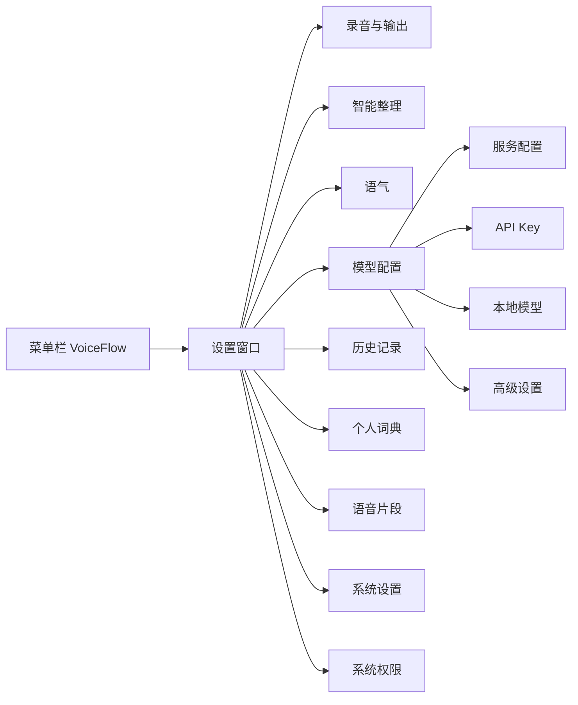
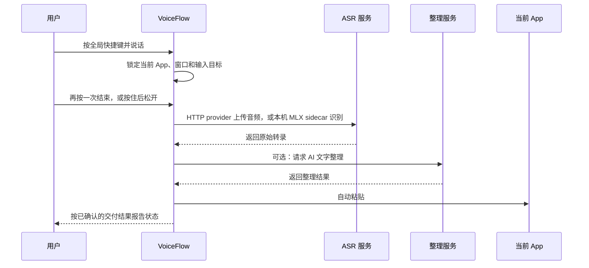

# VoiceFlow

VoiceFlow 是一个 macOS-first 的系统级语音输入工具。默认「点按切换」：按一次快捷键开始，再按一次结束；也可选择「按住说话」：按下录音，松开结束。支持 Fn / 🌐 单键和可注册的组合快捷键，默认 ⌘⌥Space。语音转换为文字后，经过可选的 AI 整理，再安全地插入当前获得焦点的 App。Esc 取消当前录音或处理。

它适合 Cursor、VS Code、浏览器、邮件、聊天、文档和终端等场景，重点解决三个问题：输入速度、技术词准确性，以及文本交付过程中的可恢复性。

> 当前版本是 macOS 优先的个人项目，最低支持 macOS 13。默认 ASR 是 Groq 批量上传，不是逐字流式字幕。On Device 使用 Swift / MLX sidecar 支持 Apple Silicon、macOS 14 或更新版本；SenseVoice Small 仅保留旧文件，不提供 MLX 推理。用户可显式下载固定 revision 的 Qwen3-ASR 0.6B、1.7B 或 Cohere Transcribe 2B 模型；Cohere 要求固定选择中文或 English。录音期间会在后台预取完整分块，但当前不会把预取文字显示到 HUD。

## 界面与交互

VoiceFlow 的设置窗口采用紧凑的双栏布局：左侧负责导航，右侧负责当前设置。设置页使用白灰或黑灰背景、连续设置行与细分隔线，支持浅色、深色和跟随系统。浅色主按钮为深灰，深色主按钮为浅灰；成功、警告和错误保留独立语义色。录音 HUD 保留独立的深灰风格。



### 设置窗口

- 设置窗口默认内容尺寸为 1035×750，不允许拖拽缩放、最大化或原生全屏；小屏按当前显示器的可用区域缩小，计算包含原生窗口边框、Dock 和屏幕缩放比例。移动到另一块屏幕或重新打开设置时会重新适配。
- macOS 设置页延伸到窗口顶部，不显示独立标题栏、「VoiceFlow 设置」文字或标题栏分隔线。原生窗口按钮融入侧栏顶部，顶部留白可拖动；侧栏品牌和导航避开按钮。加载、错误及首次引导页面共用同一拖动区域；其他平台保留原生标题栏。
- 左侧导航按「核心设置」「模型配置」「数据」「系统」分组，固定在窗口左侧；小屏适配和放大文字时可独立滚动。内容从侧栏旁统一留白，阅读区域最大宽度为 768px。
- 设置组件对齐用户提供的 Codex 参考：分组只有一层浅描边面板，内部用连续行和细分隔线；嵌套分组保持平坦。配置、预览和编辑器保留独立表面；小屏的长输入和选择器放在标签下方，开关保持行内。下拉框、输入框、普通按钮和开关使用填充表面；键盘聚焦和验证状态共用单层轮廓，不叠加边框与阴影焦点环。固定选择器使用共享浮层菜单，选中项填充并显示勾选，支持方向键、键盘搜索、Esc、焦点返回及长列表滚动。网站域名与模型名的 3 处建议输入框使用同一菜单样式，并保留自由输入与原有校验。鼠标操作不为菜单选中项额外画焦点框。未选择 Fn 时不渲染空说明行，避免额外分隔线。录音方式用填充色和勾选标记表示选择，不叠加外框与内描边；快捷键只用一层填充表面，键盘聚焦和录制时才强调轮廓。
- 「录音与输出」按日常听写、录音反馈、本地保留、更多快捷键、高级录音设置排列；日常听写集中快捷键、录音方式、识别语言和输出方式。录音方式使用紧凑分段选择，所选模式及当前快捷键的具体说明紧邻显示；选中文本、翻译、看屏幕和跳过整理收在「更多快捷键」，增益和长录音分段收在「高级录音设置」。本地保留策略保持可见。
- 「智能整理」优先显示常用整理、输出选项与窗口 OCR 授权；临时覆盖、精确转写和视觉模型放在「高级整理设置」。App / 网站规则与各来源的逐 App 授权在「语气」中设置。
- 「语气」管理写作模式，以及按 App / 网站的映射（含该 App 是否整理、是否学习词条）。「编辑哪种语气」只选择编辑对象，不切换当前听写；样例试跑标明使用当前草稿或已保存配置，保持单个实例并在 Prompt 折叠区之外，Prompt 编辑器下方提供就近的「保存语气」操作；有未保存修改时，对比同一段文字在已保存语气和草稿下的结果，区分模型、本地处理、服务回退和保护规则回退。
- 「服务配置」分别选择转写和润色服务商。默认 Groq；也可以用 OpenAI `gpt-transcribe`、Deepgram、SiliconFlow、Fireworks、Mistral、Soniox、AssemblyAI、DashScope、DeepSeek、Anthropic、Ollama、LM Studio 本机 Qwen 3.8 27B MLX 6-bit、本机 Whisper HTTP，或自定义 OpenAI 兼容端点（设置里有阿里云百炼 Qwen3-ASR、本机 FunASR、本机 mlx-qwen3-asr、本机 Whisper.cpp 预设）。AssemblyAI 对符合条件的短录音使用带整理候选的 Dictation；AI Off、本地-only 和长录音使用 raw Sync。若短 Dictation 候选失败，只有配置了共同整理凭据才会再请求该服务，否则保留原稿并使用本地回退。长录音合并 raw Sync 全稿后最多请求一次共同整理。保存设置与凭据本身不发起 provider 请求。明确点击 AssemblyAI 服务探测时只检查 raw Sync ASR，不验证可选的共同 cleanup；Soniox 在设置界面没有连接测试，密钥通过共用保存操作写入钥匙串，实时连接只在开始听写时建立。设置或凭据已保存不等于识别质量已验证。本机 Whisper 不下载 Handy 那种 ggml。本机 ASR 可选择 Qwen3-ASR 0.6B / 1.7B 或 Cohere Transcribe 2B；模型由用户主动下载并按固定 revision 和文件 SHA-256 校验。新增的 1.7B 与 Cohere 转换模型来源说明见 ThirdPartyLicenses/Models；其转换输入提交、转换器许可及转换产物许可未审查，上游 Apache-2.0 声明不等于转换产物许可结论。模型文件就绪状态不代表模型质量已验证。需要 Apple Silicon 与 macOS 14+；旧 SenseVoice Small 仅保留文件，没有 MLX 推理，模型文件就绪也不能通过本机推理探测。界面分别显示文件、运行时握手、当前模型加载中和 loaded 状态。取消加载会停止本次加载并保留已保存选择与下载文件；握手不代表实际转写成功。启动时不会下载模型。Ollama cleanup 可显式选择本机 `qwen3.5:4b`；VoiceFlow 不安装 Ollama 或拉取该模型。LM Studio cleanup 使用已加载的本机 `voiceflow-cleanup` 实例，固定模型 `qwen/qwen3.8-27b@6bit`，请求 native `/api/v1/chat` 并关闭 server-side response storage。另有需用户显式选择的 keyless `on_device_mlx` cleanup：随 VoiceFlow 打包的 Swift/MLX cleanup 子进程不依赖 LM Studio 应用、CLI 或 Python，固定来源为 `lmstudio-community/Qwen3.8-27B-MLX-6bit` revision `05f38c1f39e2f39619653616fe8e96a5d676358e`。它要求 Apple Silicon 与 macOS 14 或更新版本；VoiceFlow 应用仍支持 macOS 13，云端及现有 HTTP / 本机服务不因这条 MLX 路线而抬高最低系统版本。用户可主动下载，或导入匹配固定文件清单和配置的目录；在不支持或无法确认平台能力时，下载请求会被拒绝，且不会打开文件夹选择器。APFS clone 创建管理副本。取消保留已验证的 partial，删除只移除管理副本；已有模型文件不会因平台不支持而自动删除。首次加载与驻留状态分开展示，均不代表实际整理质量已验证。VoiceFlow 不安装 Ollama 或 LM Studio，也不会自动下载模型。清空本地 history 不会删除已下载的模型。
- 「服务配置」显示当前生效路线。修改服务、模型、区域、AI 整理开关或本机预设只改变草稿；阶段测试只检查对应草稿路线，不保存密钥或切换路线。「保存并使用」才应用设置和凭据，也可「放弃更改」。Soniox 密钥通过共用的「保存并使用」操作写入钥匙串；设置界面不提供 Soniox 连接测试，实时连接在开始听写时建立。严格离线开关仍立即执行保护策略。左侧「模型配置」分为「服务配置」「API Key」「本地模型」「高级设置」四个独立设置页，共用路线草稿、状态和模型操作。模型下载与管理在「本地模型」；Custom、本机服务地址、区域、预设和请求参数在默认收起的「高级设置」；API Key 页默认列出所有支持凭据输入的 provider，每项只有一个默认收起的编辑器；包括可选密钥的 Ollama、本机 Whisper 和 Custom。四页之间切换保留草稿，本机性能诊断默认收起。
- 语气、App 规则、服务配置、词典和片段的未提交表单在同一设置窗口内跨页面保留，关闭窗口后丢弃；不会因此写入文件、localStorage 或发送请求。手动保存的表单标明未保存状态及放弃操作，就地说明默认折叠。
- 折叠分组保留输入草稿和原有失焦提交，错误自动展开并在对应操作旁显示；快捷键录制从准备到恢复完成期间不能收起，准备期间离开页面也会恢复热键。后台词典学习等设置更新保留未保存语气草稿；展开或收起 Prompt 不会重建试跑或自动发起请求。
- App 映射默认突出 App 与语气，其余条件在「高级映射选项」中；收起不会清除设置，独立来源和风格示例授权集中在默认收起的「上下文与样例授权」中，摘要显示已开启项目数；展开、收起或阅读说明都不会修改授权。
- 「历史记录」按相邻记录的本地日期分组，保持查询顺序和分页；复制、编辑与可用重试直接可见，原文、版本、重新整理与删除在「更多操作」中。保真检查拒绝的完整整理候选与原因单独折叠显示，复制仍使用最终结果。复制成功原位提示两秒；支持「导出记录」JSON、「导出音频」、删除单条记录和清空本地数据。编辑可取消或按 Esc 放弃；保存前不允许复制、重新整理或删除旧版本。交付未确认与已复制分别标记。
- 「个人词典」将添加和词条列表放在前面，统计收在「学习统计」中；支持手动词条和 CSV / TXT / TSV 导入，以及改正学习（待确认的纠正、已生效替换、口癖草稿、置顶词）；加载或操作失败会保留已有内容并提供重试。
- 「语音片段」支持添加、编辑、启停、删除和展开全文；保存成功后才退出编辑，失败保留输入并就地重试。
- 「系统设置」管理主题、界面语言、麦克风输入设备和菜单栏图标。设备选择旁完整显示当前或选定的麦克风名称。
- 「系统权限」集中显示麦克风、自动粘贴所需的辅助功能权限，以及屏幕相关操作所需的屏幕录制权限，并提供对应设置入口。

### 菜单栏 HUD

录音时 VoiceFlow 使用一个常驻但不抢焦点的透明浮动 HUD。所有主状态共用 220×48 pt、R24 的固定胶囊；透明原生窗口折叠时为 244×64 pt。恢复和详情面板在胶囊上方展开，原生窗口可扩展至 320×116 pt，保持主胶囊的位置不变。录音时固定左侧图标和文字锚点，标题下显示实际采集设备与计时；第一帧到达前明确等待麦克风。只有当前会话 750ms 内收到的真实新鲜音频驱动电平动画，失去新鲜输入时动效暂停。停止录音进入处理，处理中的同位置方形按钮取消当前代次；Esc 仍可取消，按钮不激活前台目标 App。处理所有 ASR、整理、重试和交付阶段只显示「处理中」，不显示内部阶段、倒计时或设备信息。录音与处理使用克制的灰白渐变边缘动画；静态终态、错误、恢复和学习提示统一使用黑灰表面、白灰文字和单条中性细边，不使用彩色描边。空闲、取消和确认粘贴后立即收起 HUD。恢复提示绑定到原录音，并根据实际证据说明音频、历史或交付状态；未确认的键盘读回只说明「已尝试输入」，不代表已插入，也不会自动重试或再次粘贴。详情中的历史、麦克风、模型和服务入口只在用户主动选择时导航。词典学习提示显示本次改正内容，提供撤销和关闭；它只撤销学习规则，不撤销已交付文本。设备选择在下一次录音开始时生效；若所选设备不可用，录音失败并提供更换设备入口，不会把正在录制的会话切换到另一台设备。会话级输入错误仅恢复对应录音的音频；如果首次 History 保存失败，只能在当前保留策略仍允许访问同一 spool 时显式重试 History 写入，不会自动重转写或粘贴。引导和官网预览复用胶囊几何，不模拟真实输入：

- 空闲：保持安静，不遮挡当前 App。
- 录音中：显示真实新鲜音频电平、录音时长、本次打开设备名及采集状态；第一帧到达前显示等待麦克风。录音快捷键与 Esc 取消提示沿用现有行为。当前 App / 语气、翻译目标和实际送入已配置 provider 的上下文来源（AX、设备端 OCR、云端视觉或无）只会出现在无障碍描述中，不增加视觉行，也不会显示上下文文字。批量预取在后台运行，当前不显示预取文字。
- 处理中：ASR、整理、重试等待和交付都使用单一「处理中」标签；请求队列与具体原因留在诊断中，不显示倒计时、设备或处理计时。
- 完成：空闲、取消和确认键盘粘贴且没有回退后立即收起 HUD。复制、历史、未确认、降级和错误按实际结果保留对应恢复提示，不声称未经确认的复制或保存。
- 词典学习提示：与主 HUD 一样为 220×48 pt 胶囊，显示「已记住这个词」及改正内容；撤销忙碌或失败时显示明确状态。撤销和关闭可键盘聚焦。它只撤销学习规则，不撤销已交付文本。
- 失败或降级：按已确认的交付方式提示恢复。键盘粘贴尝试后，只有原目标和焦点仍匹配且用于确认的输入框读回与预期插入完全一致，才显示为已插入；目标或焦点变化、无法构造预期结果、读回不可用或读回不符都会显示「交付未确认」。VoiceFlow 不会再发一次粘贴快捷键；用户可主动打开详情查看历史或对应设置。确实缺少文字时再从 History 手动复制。

### 首次启动引导

首次使用的主流程为：欢迎 → 权限 → 连接服务 → 听写试用 → 完成。选中文本改写在完成页按需试用，不再占用必经步骤；未试用时保留已有文字操作开关和快捷键。

- **推荐云端路线**：Groq 默认模型，填写或复用 Keychain 中的密钥，保存配置后即可继续；密钥探测与听写试用均可稍后主动执行。Groq 密钥验证只检查身份认证，不代表所选模型识别成功。
- **本机路线**：Apple Silicon / macOS 14+，用户主动下载 ASR 模型，通过文件与运行时能力检查后试用。首次设置或主动新选择本机路线时默认只转写（关闭 AI 整理）；这项待应用默认会明确显示，也可主动选择独立整理。重新检查已有本机路线会保留已保存的 Ollama、LM Studio 或云端整理、强度和严格离线选择；Next 与 Finish 消费同一设置意图，不按 ASR 的本机属性重置整理。模型下载需要网络，不自动开始；握手不等于真实转写已成功。Cohere 要求固定识别语言。
- **高级配置**：选择其他服务商、模型和区域；保留已选配置。非默认服务商会自动展开。AssemblyAI 检查 raw Sync ASR，不检查可选的共同 cleanup；Soniox 在设置界面只保存凭据，实时连接在开始听写时建立。其他服务的手动探测不代表识别质量已验证。

欢迎页分别解释 ASR、AI 整理、History、恢复音频、成功录音保留、上下文与词典学习，并可直接进入对应设置。设置窗口始终提供「重新检查首次设置」，重新打开不会重置已有 onboarded 状态，也不会自动发送试音或整理样例。

权限页在麦克风获准后提供可选本机自检和设备选择；选择设备只代表请求设备，实际打开的设备和音频帧由自检回执确认。自动粘贴仍可跳过。用户主动开启后打开可移动原生提示窗，使用当前运行 App bundle 的文件卡片拖拽或系统添加 / Finder 路径；无可用 App bundle 时明确使用替代路径。系统窗口位置无法可靠取得时保留独立可移动提示，不使用截图或固定箭头猜位置。拖拽结束不代表授权，本机权限读回才确认完成。普通听写不请求屏幕录制。

快捷键保存 / 注册、原生快捷键回调、真实实体按键验收、录音帧、应用内结果和外部插入分别记录。原生回调也可能来自合成按键，因此不作为实体按键证明。试用订阅和结果绑定原生 trial_id、配置 generation 与录音 generation；generation 以无损十进制字符串传入 UI，草稿 revision 不代替原生版本。返回、取消、配置变更或离开时以同一 trial_id 释放，旧释放不会取消更新的试用；释放失败仍保留所有权并提示重试。

应用内试用只更新试用框，不向其他 App 粘贴，不能证明外部交付。选中文本试用使用本次选区快照，来源改变时保留结果供手动复制。完成页按当前配置显示已测 / 未测 / 未确认，提供重测、历史恢复和词典 / 上下文 / 语气设置入口。外部插入独立 oracle 验收仍未接入，不会显示未经确认的外部成功。

引擎页可按需查看 Auto / Off / Light / Standard / Heavy，使用既有语气试跑处理手动样例并显示保护回退。首次新选择本机路线默认只转写；已有独立整理可保留，新选择也可显式启用整理。待应用默认尚未保存时不提供会读取旧设置的试跑；保存选择后复用真实配置预览，不读取私人上下文或 History，不写词典学习。

个人词典、语气与 App 来源规则、更多快捷键、选中文本可选试用和已捕获的操作预览均提供可收起、重看的就地说明。首次进入相关词典 / 语气页面或实际试用 / 预览时，尚未确认的说明可在页面内展开，不移动焦点；快捷键页内的说明始终按需打开。四类说明的「知道了」由原有本机设置独立记录教学版本；关闭、完成试用或收到成功提示都不代替确认。保存阅读状态不会开启任何来源授权、重置首次配置或改变听写配置版本，读取或保存失败不冒充已确认。

词典说明使用明确标记的固定术语和错词示例，连接现有添加、History 纠错和 App 学习设置，不会把示例自动加入词典；保留人名第 2 次 / 术语第 3 次规则、忽略 / 忘记后的阻止再学习记录，以及已晋升词条按保存的 App / 网站 / 映射 / 通用范围逐项核对；所需当前来源未知时不替换。上下文说明分别解释 AX 文字、本机 OCR、provider 文字、云端图片和风格样例用途；系统权限入口仅导航，仍需用户主动打开权限提示。选中文本说明不执行旧选区，固定原稿的真实试用仍使用当前原生 lease，结果只进入试用框或既有事务预览。语气说明复用现有 Prompt、映射、保存 / 草稿对比试跑；只有主动试跑才可能请求整理服务。风格草稿的确认会显示实际前后文字并明确批准后续 App 整理请求，可在对应规则撤销；教学链接离开有未保存输入的语气页前沿用原有确认框。

### 麦克风自检与学习反馈

「系统 → 音频输入」和引导权限页可主动开始最多 30 秒的麦克风自检。显示实际打开的设备（含合盖选择）、输入增益、实时音量与无输入 / 轻声 / 峰值过高提示。只测量音量，不保存音频、不启动 ASR / AI、不写 History；正式听写、设备设置变化、离开页面或测试到期时退出。开发构建中开启常开麦克风时，结束自检后恢复原本的空闲输入流；发行构建忽略已保存的开启值，也拒绝通过设置字段修改该选项。

「个人词典」显示待确认、生效替换、最近更新的纠正，以及实际用于本机替换的词条和处理次数。每段处理按词条计一次（包括历史重新整理），从新增记录开始累计，不回填旧数据。它不表示识别准确率或成功插入次数。未发生实际替换的提示词命中不算收益；词条已没有生效规则时，不再显示该词的收益记录。关闭学习只停止新纠正的自动观察，已生效替换继续可用；「清空全部数据」删除本机反馈记录。

「学习审查：来源、原因与保存步骤」由用户按需展开，只读取普通产品的本机审查接口；不读取研究 sink，也不重新采集输入框、History 或模型结果。它分别展示本次运行最后 128 项无文本活动及丢失计数、观察与拒绝原因、候选数据库 / 设置文件的独立调用结果，以及保存的词语 / 风格 / 整理强度规则（包括 tombstone）。旧规则的原始来源和忽略 / 撤销原因仍可能未知；当前分类是本次读取推导，整个输入框有变化不证明 ASR 错误、插入段纠正或人的意图。实际词条使用次数仍来自原有独立统计，多个规则共享同一目标词时不重复累计。

审查的稳定版本只覆盖审查元数据，不承诺数据库与设置的一致事务、无在途写入或当前操作授权。变化中、旧版本、读取失败及容量超限明确显示不可用或可能过期；容量超限不冒充空列表或截断后的完整成功。更新提示只有运行 ID 与审查版本，用于有界刷新，无轮询或自动重试循环；关闭后解除订阅并丢弃迟到读取。审查没有确认、撤销或焦点跳转按钮，操作仍使用现有普通控件的独立准入。活动重启后消失，既有规则仍按保存的来源范围逐项核对；审查读取不改变学习授权或 ASR 配置代际。

### 录音样本评测

`npm run eval:audio -- --help` 启动显式 `evaluation` feature 的 `voiceflow-eval`，由 Rust 统一校验 WAV、schema、路径与 SHA。默认只校验；`--init` 创建待审核模板，`--run` 才调用明确选择的模型。旧选型保留 `legacy_fixed` 控制；新 `--corpus-sidecar` / `--experiment` 支持分片语料、严格身份与完整 case 记录，可加入 `--non-speech`。新 recipe 可声明 auto/zh/en、SHA 绑定的词表/context 和逐 case 本地规则；builder 返回实际构造字段与分阶段来源。未保护 cleanup reply 只在显式 `capture_provider_candidate:true` 时记录；显式 `quality_replay` + TTL 可用 `--checkpoint` / `--resume` 重放 SHA 绑定的云文本候选，当前 guard/finalizer 重跑；不能算当前云质量、性能或可靠性，V3 本机 ASR 可显式选择同一 replay policy，经本次真实 load 的 runtime/Metal/image、parameter dtype/layout 和 tokenizer 身份严格匹配后复用 schema2 checkpoint；缺身份时明确拒绝 replay，普通 fresh 路径继续兼容旧 sidecar。未支持的 decoder 控制、其他未接线候选与不匹配 checkpoint 在凭据读取前拒绝。样本、参考稿和报告放在仓库外，不读取麦克风、Keychain 或 History。使用范围、当前限制与示例见 [评测协议](docs/cleanup-evaluation.md#reviewed-audio-pipeline-entry-point)，文件评测本身不证明识别质量或 macOS 自动粘贴成功。

本机 Qwen3-ASR 文件评测可在 experiment 中显式选择 `local_qwen3_asr_0_6b` / `local_qwen3_asr_1_7b`：`--models-root` 选择只读的既有固定模型文件，`--models-work-root` 指定本次新建的独占可变工作目录。验证不加载模型；运行不自动下载、不读默认模型目录、不回退云 ASR。本机 ASR 无需云 key，整理 Off 也无需 LLM key。文件校验、运行时握手、模型加载与推理分别记录；真实模型和端到端质量仍需独立验收。具体契约见 [文件评测](docs/cleanup-evaluation.md)。

## 核心工作流



### 语音输入

- 默认「点按切换」：按一次开始，再按一次结束；按住不会重复触发。
- 「按住说话」：按下开始，松开快捷键中的任意一个键结束；短按也会结束，不锁定持续录音。
- Fn / 🌐 点按只在独立按下并松开后切换；Fn 组合操作不触发点按，按住录音中形成 Fn 组合则取消本次录音。
- 快捷键显示为紧凑按键标签，点击后就地录入，保留当前绑定说明与 Fn / 取消操作；主听写可恢复默认 ⌘⌥Space，可选快捷键另有清除。只在录入框捕获组合键，原生确认所有物理键松开后保存；Tab / Shift+Tab 正常导航，捕获期间的 Esc、点击外部、焦点离开或切换 App 取消。按物理键识别，Option 产生的字符和 Shift 标点不会改变绑定。保存和取消等待原生完成，跨页面的迟到恢复按顺序执行，不干扰下一次录制；失败在原位说明原因并可重试。
- 快捷键录制只保存绑定，不改变录音方式。新绑定要求 ⌘ / ⌥ / ⌃ 与其他键组合，或使用功能键；单键录音可显式选择 Fn。普通字母、空格、Tab、Enter 和 Shift 字母不接受新绑定，已有合法配置保留。旧单独 ⌘ / ⌥ / ⌃ / ⇧ 绑定保留显示并暂停注册，需改为 Fn 或组合键。
- Fn 的系统输入法、表情、听写动作由用户在 macOS 键盘设置中调整，VoiceFlow 不自动修改系统设置。
- schema 25 将旧 `double_tap`、`hybrid` 和历史 `hold` 统一迁为 `tap`；新的纯按住值为 `hold_to_talk`。更新说明提示一次。
- 录音或处理时暂时禁止修改绑定与方式。绑定和模式保存校验配置合法性，不要求未更改的语音密钥；服务修改、完成引导和开始录音仍检查就绪状态。注册或写入失败恢复原绑定与页面值，取消录制等待按键松开后恢复监听。
- 全局快捷键可在不同 App 中使用。
- 「录音与输出 → 本次翻译」可配置独立快捷键（Fn 或组合键）和目标语言，空着表示关闭。只切换它启动的那次录音，与全局快捷键使用同一按法；不会更改全局输出模式。录音中 HUD 显示目标语言。当前场景须允许 AI 整理并配置整理服务；严格离线时只允许 On Device ASR，并允许经验证的本机 Ollama、LM Studio 或 VoiceFlow 管理的 `on_device_mlx` cleanup。服务失败仍走现有回退与交付提示，不宣称翻译成功。
- 支持自动检测中文、英文和中英混合语音，也可以手动指定语言。
- 长录音会自动分段，避免单次请求过大。
- 如果目标 App、窗口或焦点输入框在处理期间发生变化，VoiceFlow 会停止自动注入；只有对应 History 或剪贴板 owner 确认完成后才报告该交付方式，未知结果不会宣称已复制或已保存。
- History 保存成功时，会分开记录本地处理后的识别草稿、provider 原始文字（`asr_text`），以及实际产出文本的 ASR provider/model（`engine`）；写入失败或状态未知时不会宣称已保存。可恢复音频是否保留取决于恢复 spool 的实际写入和保留策略；旧记录没有原始字段或 provider provenance 时保持为空。

### AI 文字整理

AI 整理默认使用 Groq 上的 `openai/gpt-oss-20b`。这是为了避免将于 2026-08-16 对免费 / Developer 账户停用的 `llama-3.1-8b-instant` 和 `llama-3.3-70b-versatile` 作为新设置默认；已保存的 Llama 模型 ID 会保留，企业账户仍可使用。这个默认调整只处理服务可用性，不代表质量提升。也可以选 Groq 上的 `openai/gpt-oss-120b`，或使用 OpenAI、SiliconFlow、DeepSeek、Anthropic、Ollama、本机 LM Studio Qwen 3.8 27B MLX 6-bit、VoiceFlow 管理的本机 MLX cleanup 和兼容服务。终端和表单默认只做本地规则，不请求整理服务。[Groq 模型停用说明](https://console.groq.com/docs/deprecations)

整理逻辑会尽量：

- 移除口头禅、重复和明显的语音识别噪声。
- 处理自我纠正，例如「周四，不对，周五」。
- 修正标点、大小写、空格和段落。
- 保留 URL、邮箱、路径、命令、参数、版本号、错误信息和专业术语。
- 保留原始语言和中英文混合表达，不擅自翻译、总结或扩写。
- 在模型请求失败、输出为空或未明确成功结束（含截断、过滤与工具响应）时，回退到完整准备稿或本地规则整理。

关闭 AI 整理后不会请求文字整理服务；此前已启用的口述标点、明确自我修正、场景允许的词典替换和语音片段仍按各自设置处理。清理阶段本身会保留传入文本，History 的 `asr_text` 仍单独保留 provider 原文。

### 选中文本操作

通过独立快捷键启动后，VoiceFlow 需要辅助功能权限，并会读取当前选区；没有选区时，也可读取受支持的可编辑字段全文或空回复框。语音只接受六类明确操作：改写、精简、翻译、结构整理、起草回复，以及按指令修改一个值或术语。超过 16 KiB 的来源会被拒绝。若辅助功能只能读到选中文字、无法确认原字段或精确选区，文字仍可用于生成预览，但结果只能复制；不会用当前剪贴板内容代替来源。

生成结果先经过有限的事实保留检查，再显示为可编辑预览。检查用于拦截可识别的名称、数值、路径、版本和否定变化，并不证明语义正确。你手动编辑的预览是自己的文字，不会被标记为模型检查通过。确认时，VoiceFlow 会再次核对目标和来源；若在交付前发现选区或目标变化、或无法验证，只复制结果。若已经尝试写入但系统无法确认结果，会报告未验证，不会盲目重试。完整字段只通过验证过的辅助功能字段替换，不会在未知光标位置追加。动作不会按 Enter 发送内容，也不会执行命令或跨 App 操作。

每次预览由一次性事务 ID 和递增序号关联；重复确认无效，取消或更新动作会清除预览并阻止迟到结果复活。来源、语音指令和结果仅用于这次操作，不写入普通 History、纠错学习或导出。起草回复只在空回复框中进行，并且只有当前 App 规则明确允许读取及发送有界辅助功能文字时才会使用附近页面文字。

选中文本和看屏幕操作使用与普通听写相同的录音、ASR 和完整覆盖分段路径。若语音识别失败，完整录音按恢复策略保留在 History，之后可显式重试；长音频会分段完整识别。History 重试只复制结果，不恢复原目标或预览来源。操作成功时的来源、指令和预览仍只存在于本次事务。

### 看屏幕

独立于听写和选中文本操作的可选热键。用户设置快捷键并配置视觉模型后，才会截取当前窗口一张内存图，连同语音指令发给该模型，并显示同一套一次性事务预览（替换 / 只复制 / 取消）。确认前会重新核对目标；不能验证时只复制。默认听写不截屏；自动视觉上下文另由每条具体 App 规则的云端视觉权限控制。取消会丢掉图片；History 不保存截图。需要屏幕录制权限。会议录音、Spark 和生图仍不提供。

## Context-aware 输出

VoiceFlow 可以根据当前 App、窗口、焦点控件、经过授权的浏览器 host / 页面路径选择写作策略。规则中填写的 App、可执行文件、host、路径前缀和焦点字段必须全部匹配；更具体的网站 / 路径 / 字段规则优先于通用 App 规则，完整并列时按规则 ID 决定。缺少某个已指定的信号时不会匹配。写作场景元数据与读取文字是分开的权限。场景还会参考正向识别的字段类型：IDE 的通用编辑字段保持未知，只有明确的 chat/composer/prompt 字段按 coding prompt 处理；GitHub issue / pull request 只有在对应页面且字段标签足够明确时才区分标题、正文和评论；Slack / WeChat 搜索框按 Search 处理。原始字段标签仅用于本机短暂分类，不进 provider prompt 或 History。

自动读取文字默认关闭。逐 App 规则可分别允许有界 AX 选中 / 邻近文字、本机 OCR、云端视觉，以及将有界 AX/OCR/视觉识别文字送到用户配置的 ASR 或 cleanup provider。OCR 即使在本机识别，文字获准加入 provider 请求后也可能离开这台 Mac。自动云端视觉要求具体 App / 可执行文件规则、云端视觉和文字使用权限；host-only 浏览器规则不能开启截图。若获准的 AX 内容已足够，或 OCR 内容已足够，就不会请求云端视觉；OCR 和云端回退共用录音中至多一张当前窗口图。需要屏幕录制权限。普通听写不会截取整屏，也不会默认读取或上传窗口文字 / 图片。

VoiceFlow 可以按以下场景选择写作策略：

- Code
- Search
- Email
- Team collaboration
- Chat
- Document
- Terminal
- Calendar / task
- Form
- Notes
- Social
- General

Context 只作为文字整理的软提示，用户实际说出的内容优先。未知 App 会使用更保守的 General 策略。

raw URL、查询 / 片段、窗口标题、PID 和目标身份只用于本地规则与安全检查，不会发送给 LLM 或写入 History / 导出。AX、OCR、视觉文字和保留的风格样例也只有在对应 App 权限明确开启后才会进入 provider 请求。手动选中文本快捷键只授权这次选中的文字，不会附带无关的邻近文字；手动看屏幕仍是独立热键。

## 隐私与安全

- 新建或替换的服务商 API Key 只写入 macOS Keychain，并在读回验证成功后才保存设置；写入失败会报错，不会退回明文 sidecar。旧版 `settings.json` / `secrets/` 中的明文值会保留到安全迁移验证成功，且 API Key 不返回给前端。
- 默认按需打开麦克风；开发构建可选常开麦克风会持续打开输入设备，但空闲样本直接丢弃、不保存、不发送。发行构建忽略已保存的开启值，并拒绝该设置字段更新。会话样本只在用户触发录音后进入处理。若麦克风权限尚未决定，首次触发听写会由 macOS 显示授权提示；未允许时不会开始采集，可从「系统权限」页重新打开设置。
- HTTP ASR 会把音频发到用户配置的转写服务；On Device 音频发送给本机 Swift / MLX sidecar，模型由用户显式下载并留在本机。文件校验、能力握手或模型加载状态都不代表实际转写成功。严格离线模式只允许 On Device ASR；所有 HTTP ASR 路由都被阻止，包括配置为 loopback 的 LocalWhisper / 自定义 endpoint，以及对应引擎探测。它也会取消进行中的云端 cleanup 与视觉请求，并阻止新的云请求、重试、cascade / prefetch 和云端文字操作，同时保留已保存的 provider 选择。cleanup 可单独使用经验证的 loopback Ollama、经同一固定服务确认本机来源的 LM Studio `voiceflow-cleanup` 实例，或无网络请求的本机 `on_device_mlx`。显式 ASR / cleanup 模型下载均需要网络且由用户主动发起；本机文件夹导入不发送模型内容到 provider。文字只发到用户配置的整理服务；转写和润色可以不是同一家。
- 当前版本不收集 telemetry。
- 录音目标在开始时锁定；目标改变会停止自动注入。History / 剪贴板交付只在对应 owner 确认后报告，目标变化本身不证明剪贴板写入。
- History 重试只复制，不会把旧记录注入到当前可能不同的 App。macOS 重试在内存中捕获有界的本机剪贴板快照，并由现有 pasteboard owner 在写入前复核全部 item、type 和 bytes，再验证临时文字与唯一所有权标记；快照不持久化，也不发送给整理服务。快照读取失败或内容变化时不写剪贴板，识别结果仍保存到 History；写入/所有权证明不确定时也保留 History 结果并显示未确认。其他平台没有这条 native item-level 准入路径时只保存 History。系统没有原子 compare-and-write，最终复核和声明写入之间仍存在窄竞态。你主动点击「复制」仍按该明确操作复制记录。
- 支持配置恢复音频和历史文字的保留时间，也支持导出、删除和清空。清空 history 不会删除 `app_data_dir/models/` 里的本机模型。
- 正常退出会取消活动处理并关闭 ASR 与 cleanup 两个 On Device sidecar，按持有的文件身份清理私有临时音频，清理失败保留恢复状态；模型文件、provider 选择、History 与恢复 spool 按各自的保留策略保留。
- 默认 history SQLite 和恢复音频依赖 macOS 文件权限；可选的 recovery spool 应用层加密不会默认开启。

完整数据流和删除说明见 [`docs/privacy.md`](docs/privacy.md)。

## 技术栈

- **Frontend**：React 19、TypeScript、Vite、Tailwind CSS、Lucide React
- **Desktop runtime**：Tauri 2
- **Backend**：Rust、Tokio、Reqwest、SQLite（rusqlite）
- **Audio**：CPAL、Hound、Rubato
- **ASR**：默认 Groq `whisper-large-v3-turbo`；也可选 OpenAI `gpt-transcribe`、Deepgram、SiliconFlow SenseVoice、Fireworks、Mistral、Soniox、AssemblyAI、DashScope、本机 Whisper HTTP / MLX，或自定义 OpenAI 兼容端点
- **LLM cleanup**：默认 Groq `openai/gpt-oss-20b`；也可选 Groq 其他模型，以及 OpenAI、SiliconFlow、DeepSeek、Anthropic、Ollama、本机 LM Studio `qwen/qwen3.8-27b@6bit` 或自定义端点
- **macOS integration**：Keychain、Accessibility、microphone、menu bar、transparent floating panel

前端通过 Tauri commands 与 Rust 后端通信；音频采集、权限检查、上下文快照、Keychain、网络请求、历史记录和文本交付都由后端负责。

## 本地开发

### 官网首页

`website/` 是独立的 React / TypeScript / Vite 官网，提供中英文切换和聊天、邮件、开发提示词三种本地演示。演示进入视野后自动循环播放口述、整理与逐步成文，支持暂停、继续和重播；离开视野或切到后台时暂停，减少动态效果时默认显示静态结果。网页 HUD 复用桌面产品的 220×48 胶囊、球体、状态、动画和 CSS；预设时钟只在演示录音阶段显示。演示保留短暂的完成检查点用于讲解流程；桌面应用在确认粘贴后立即收起。界面明确标出预设演示且不使用麦克风；播放只在浏览器本地运行，不调用转写服务。官网与桌面应用分别安装依赖、启动和构建；官网构建只需安装 `website/` 依赖，复用的纯 UI 源码不调用 Tauri。

在仓库根目录运行（需要 Node.js 20.19+ 或 22.12+）：

```bash
npm ci --prefix website
npm run dev --prefix website      # http://127.0.0.1:5173
npm run lint --prefix website     # 官网 TypeScript 检查
npm run build --prefix website    # 静态产物：website/dist/
npm run preview --prefix website  # http://127.0.0.1:4173
```

部署时将 `website/dist/` 作为静态站点发布。字体、Logo 和演示素材随站点托管；官网界面图标使用 [Hugeicons](https://hugeicons.com/) 的免费 Stroke Rounded 系列，统一 1.5 线宽。字体、图标与动画库许可见 `website/public/licenses/`。官网入口打开 GitHub 最新发行版页面，用户可下载该版本实际提供的 `VoiceFlow.dmg` 或 `VoiceFlow-unsigned.dmg`；下载版本的功能以对应发行说明为准。网页仅在浏览器本地记住语言选择。

### 桌面应用

环境要求：

- macOS 13+
- Node.js 22 LTS（22.13+）或 24 LTS
- Rust toolchain
- Xcode Command Line Tools

macOS 13 是云端与现有 HTTP 路线的最低系统版本。随包提供的 MLX 路线要求 Apple Silicon 和 macOS 14 或更新版本；Intel 尚未完成发布验收，universal 构建选项不代表 Intel 已受支持。尚无经发布验收的最低内存要求，也不承诺特定内存占用或 RSS。

Apple Silicon 上构建 MLX sidecar 和 Metal 资源还需要完整 Xcode；`npm run tauri dev` 和 `make dmg` 会执行 sidecar 打包脚本。脚本通过所选 Xcode 的 `swift-stdlib-tool` 将 helper 所需 Swift compatibility runtime 放在 helper 旁，并在暂存目录中包含 MLX 上游 LICENSE/NOTICE 文本和依赖身份清单；Tauri 现有资源映射会一并打包。普通 `cargo test` / `cargo check` / `cargo clippy` 可在干净检出中直接运行：debug build 会创建空的 MLX 资源暂存目录供 Tauri 检查，不生成或伪装可用的 MLX runtime。正式安装包仍由打包脚本生成实际 sidecar、运行库和 Metal 资源。

安装依赖并启动开发模式：

```bash
npm ci
npm run tauri dev
```

常用命令：

```bash
npm run dev          # 只启动 Vite 前端
npm run build        # TypeScript 检查并构建前端
npm run lint         # TypeScript 类型检查
npm test             # 运行前端测试

cd src-tauri
cargo fmt --check
cargo test
cargo clippy --all-targets --all-features -- -D warnings
```

构建 macOS 安装包：

```bash
make dmg
```

产物写到 `.build/release/VoiceFlow.dmg`（不用仓库根目录的 `dist/`，那是 Vite 前端输出）。把 `VoiceFlow.app` 拖进 `/Applications`。

签名、第一次打开被拦截、以及为什么以前每次更新都要在系统设置里移出再添加权限，见下面的 [签名与权限](#签名与权限)。

## 签名与权限

macOS 的 TCC（辅助功能等）绑的是**代码签名身份**，不是 bundle id，也不是「看起来还叫 VoiceFlow」。未签名或 ad-hoc（`codesign -s -`）的包按**这一份二进制的哈希**识别。一重新编译或换包，哈希就变了。系统设置里旧条目可能还是开着的，但已经对不上新 copy，只能移出再添加。

这就是以前每次 update 都要重新授权的原因。

### 这个仓库怎么做

`make dmg` 默认要求成功解析稳定签名身份（本机缺少时会尝试创建自签证书；这不是 Apple Developer Program，也不是公证）。签名身份或 Team ID 无法解析、创建失败时，构建默认失败；只有显式设置 `VOICEFLOW_ALLOW_UNSIGNED=1` 才会允许未签名构建，并输出 `VoiceFlow-unsigned.dmg`。空值、`0`、`true` 等不会启用回退。

| 做法 | 结果 |
|---|---|
| 未签名 / ad-hoc | 绕过 Gatekeeper 后能跑。每次更新权限都会丢。 |
| **稳定自签（本仓库默认）** | 每次 `make dmg`、以及导入同一张 `.p12` 的 GitHub Release，都是同一个身份。权限能保住。第一次打开仍要自己放行。 |
| Apple Development | Xcode 免费证。只在**你这台 Mac**上稳。不能公证。除非导出去，否则不能当 GitHub Release 的身份。 |
| Developer ID + 公证（`make notarize`） | 可生成经公证流程验证的 DMG；实际首次启动信任仍需在目标 macOS 环境验证。需要有效的 Developer ID 与公证凭据。 |

不把 ad-hoc 当默认。它最多把「已损坏」变成「无法验证开发者」，**保不住** TCC。

证书名称是 `VoiceFlow`，Team ID 是 `VOICEFLOW1`。designated requirement 变成这张叶子证书，之后用同一张证签的包会继承授权。

**这不是公证。** 别人第一次打开仍会被 Gatekeeper 拦。自签解决不了双击即用。

不要和别的 app 共用这张证。Mac Clippy 用的是另一套身份（`Mac Clippy` / `MCLIPPY001`）。

### 生成一次证书

```bash
make signing-cert
```

macOS 可能会要登录钥匙串密码，以便信任这张证。私钥写在 gitignore 里：

```text
.build/signing/VoiceFlow.p12
.build/signing/VoiceFlow.p12.base64
.build/signing/password.txt
```

不要把这些文件提交进仓库。如果钥匙串里已经有 `VoiceFlow`，脚本会直接退出，不会再做一张新的。

`make dmg` 发现没有这张身份时也会走同一条创建路径，所以第一次打 DMG 也可以顺便建证。

### 构建并安装签过名的 DMG

```bash
make dmg
```

未设置 `APPLE_SIGNING_IDENTITY` 时的签名身份选择顺序：

1. `VoiceFlow` 自签（保证本地包和 GitHub Release 是同一个身份）
2. Developer ID Application
3. Apple Development

可用 `APPLE_SIGNING_IDENTITY` / `APPLE_TEAM_ID` 覆盖。身份或 Team ID 无法解析、创建本地证书失败时，默认停止构建；只有 `VOICEFLOW_ALLOW_UNSIGNED=1` 精确值允许继续未签名构建，并产出 `.build/release/VoiceFlow-unsigned.dmg`。`make release` 默认打 `app,dmg`；`make dmg` 只打 DMG。

只保留一份：把权限授给 `/Applications/VoiceFlow.app`。`npm run tauri dev` 仍是未签名。日常用 dev 覆盖运行，权限还是会丢。

### 第一次打开（Gatekeeper）

浏览器或 GitHub 下来的包会带 `com.apple.quarantine`。没有公证时，系统可能说无法验证开发者；若完全未签名，还可能说「已损坏」。

1. 系统设置 → 隐私与安全性 → 仍要打开
2. 或只清这一个 app 的隔离属性：

```bash
xattr -dr com.apple.quarantine /Applications/VoiceFlow.app
```

不要关全机 Gatekeeper。

### 从旧的未签名 copy 迁过来

如果辅助功能开关是开的，但签过名的新包仍说没权限，那是旧的哈希条目还在。清一次再授：

```bash
tccutil reset Accessibility com.voiceflow.desktop
```

用 `VoiceFlow` 这张证签出来的 DMG 覆盖 `/Applications/VoiceFlow.app`，打开后再授权。之后同一张证的更新应能保住。

### GitHub Release

`.github/workflows/release.yml` 会先复用四个 CI job，通过后才构建并用 GitHub CLI (`gh`) 发布 DMG（不是 Vite 的 `dist/`）。当前 `package.json` 版本是 `0.1.4`；tag 必须匹配版本，手动触发只允许从 `main` 运行，并会在导入签名证书前检查分支。两种触发方式：

1. **Actions → Release → Run workflow** — 从 `main` 运行，用 `package.json` 的版本当 tag（现在是 `v0.1.4`）。
2. **推送匹配的 tag**：`git tag v0.1.4 && git push origin v0.1.4`。

要让别人更新时权限还在，Actions 必须用**同一张**证：

```bash
make signing-cert
gh secret set MACOS_CERT_P12 < .build/signing/VoiceFlow.p12.base64
gh secret set MACOS_CERT_PASSWORD < .build/signing/password.txt
```

```bash
git tag v0.1.4
git push origin v0.1.4
```

签名状态以 workflow 实际解析到的身份和 Team ID 为准：有效身份会发布 `VoiceFlow.dmg`，release notes 标为 signed；没有身份时默认失败。只有在仓库 Actions variables 中显式设置 `VOICEFLOW_ALLOW_UNSIGNED=1` 才允许未签名发布，此时资产名为 `VoiceFlow-unsigned.dmg`，release notes 标为 unsigned；只要解析到有效身份，即使该变量为 `1` 仍会签名。上传重名资产会失败，不会覆盖已有文件。CI 的 reusable workflow 不接收签名 secrets。Release workflow 在导入证书前校验标签版本及源 commit；手动发布若版本标签已存在，标签（含 annotated tag 解引用后的 commit）必须与本次 `main` 构建 commit 相同，若标签不存在则只会在该 commit 创建发行版。Signed 仅表示代码签名，不代表 Apple notarization。

CI **不会**在 runner 上现做一张新证。每次新证都会让所有人的 TCC 悄悄失效。

### 可选：Developer ID + 公证

别人双击、无警告，仍然需要付费账号：

```bash
APPLE_SIGNING_IDENTITY="Developer ID Application: Your Name (TEAM_ID)" \
APPLE_TEAM_ID="TEAM_ID" \
APPLE_ID="developer@example.com" \
APPLE_PASSWORD="app-specific-password" \
make notarize
```

`make notarize` 默认以 `aarch64-apple-darwin` 构建 arm64 App；可显式设置 `VOICEFLOW_RELEASE_TARGET=universal-apple-darwin` 选择 universal 输出。脚本只构建 App，先验证 MLX sidecar 的 ASR 与 cleanup JSONL hello（不加载模型或执行推理），并核对包内锁文件、依赖身份 SHA-256 声明、第三方 notice、Models/Upstream 文件清单与内容及 DependencyTexts。随后将 App ZIP 提交公证并要求带有非空提交 ID 的 `Accepted` 结果，再对同一 App 装订、验证票据，然后从已装订 App 创建并签名独立 DMG。DMG 会单独提交公证、装订和验证；发布前还会挂载 DMG，重新核对这些打包来源并检查其中 App 的票据、签名、架构和 Gatekeeper 评估。ZIP 提交前及最终挂载 App 上还会核验默认生产 CLI 的拒绝行为，并扫描包内主程序、MLX sidecar、Swift runtime 及其他 Mach-O 文件的字符串，遇到缺失、读取或扫描错误即停止发布。默认产物是 `.build/release/VoiceFlow-notarized.dmg`，旁边的 `VoiceFlow-notarized.receipt.json` 分别记录 App ZIP 与 DMG 的提交 ID、状态和提交前 SHA-256，以及装订后最终 DMG 的 SHA-256。私用 `make dmg` 默认写入 `.build/release/VoiceFlow.dmg`；仅在 `VOICEFLOW_ALLOW_UNSIGNED=1` 且没有可用签名身份时，产物写入 `.build/release/VoiceFlow-unsigned.dmg`。该开关不会放宽 `make notarize` 的 Developer ID 身份、匹配 Team ID、Apple 凭据或严格 App/DMG 验证要求。保留的 universal 路径不构成 Intel 支持验收。此流程不承诺最低内存要求或 RSS 数值，也不证明该包已在干净 Mac 上通过 Gatekeeper 首次启动。完整检查见 [`docs/release-checklist.md`](docs/release-checklist.md)。

### 相关脚本

| 脚本 | 作用 |
|---|---|
| `scripts/make-signing-cert.sh` | 生成一次 `VoiceFlow` 身份并导出 `.p12` |
| `scripts/select-codesign-identity.sh` | 优先自签，然后 Developer ID，然后 Apple Development |
| `scripts/resolve-dmg-signing.sh` | 本地缺证就创建；打印 `APPLE_SIGNING_IDENTITY` 和 `APPLE_TEAM_ID` |
| `scripts/import-signing-cert.sh` | Release runner 导入 `MACOS_CERT_P12` |
| `scripts/stage-dmg.sh` | 把 Tauri 打出来的 DMG 拷到 `.build/release/VoiceFlow.dmg` |
| `scripts/select-codesign-identity-test.sh` | 身份优先级的 fixture 测试 |
| `scripts/release-macos.sh` | App 与独立 DMG 两阶段 Developer ID 公证、receipt 和最终 DMG 校验 |

CI 的 macOS job 会跑身份选择测试。

## 项目结构

```text
.
├── AGENTS.md            # Agent 约定：命令、文档分层、保守清理
├── src/                 # React 设置界面、HUD 和前端测试
├── src-tauri/src/       # 音频、ASR、LLM、权限、Keychain、历史记录
├── src-tauri/icons/     # 应用和菜单栏图标
├── public/              # 前端静态资源
├── scripts/             # 自签、DMG 发布、可选公证
├── docs/                # 活文档与研究对照；见 docs/README.md
├── package.json         # 前端脚本和依赖
└── src-tauri/Cargo.toml # Rust 依赖和 Tauri 配置
```

## 当前限制

- 目前以 macOS 为主要目标平台，Windows/Linux 尚未作为完整产品体验验证。
- 默认 ASR 仍是批量上传，不是真流式 ASR；完成的预取结果仅在录音结束后用于最终组装，且只有样本区间、音频内容和请求设置都一致时才复用，其余缺口会重新转写。
- 中文听写可以在设置里改用 SiliconFlow SenseVoice，或自定义 Qwen3-ASR / 本机 FunASR / 本机 mlx-qwen3-asr 端点；产品默认仍是 Groq Whisper。本机英文 Whisper 可走 whisper.cpp，模型名可用 Handy 同款 ggml 文件名。
- 自动粘贴依赖 macOS Accessibility 权限；没有权限时仍可复制到剪贴板。
- 看屏幕依赖屏幕录制权限和用户配置的视觉模型；没配模型时拒绝截屏。
- 浏览器上下文能力依赖用户明确授权。
- 本项目处于早期版本。默认 DMG 使用稳定自签；Developer ID 公证仍是可选的公开分发路径。

## License

License 尚未确定。项目依赖及其许可证说明见 [`THIRD_PARTY_NOTICES.md`](THIRD_PARTY_NOTICES.md)。

### 可选录音与系统控制

「录音与输出」可设置独立的「本次跳过 AI 整理」快捷键，默认为空。它只决定由该键成功启动的本次听写；用该键结束普通听写不会改变普通会话策略。仍有本地处理和词典替换，并使用所选 ASR 服务；AssemblyAI 使用 raw Sync，共同 AI 整理（含 Ollama 和 LM Studio）关闭。History 重试按当前设置运行。

录制可选快捷键时，Backspace / Delete 清空绑定，Esc 取消并保留原绑定；主听写快捷键不能清空。普通和跳过整理的按住状态分别绑定到各自热键，松开另一枚键不会结束当前按住的录音。主键注册失败后会尝试恢复原有辅助绑定。

提示音默认关闭，音量默认 0.6；开始音等待本次有效采样，结束音在采集停止后播放。「系统设置」提供合盖时的输入设备和登录后台启动（默认关闭）；后台启动不打开设置窗口。设备不可用仍明确报错。手动打开应用显示设置。

登录启动开关显示系统实际状态；显式切换会核对并纠正系统与保存值的差异，保存失败会回滚系统改动。修改其他设置不会覆盖在系统中单独调整的登录启动状态。

开发构建中，Cmd+Shift+D 在非编辑状态切换隐藏调试页，包含句尾缓冲（默认 250ms，0–2000ms）、可选 VAD、ASCII 模糊词典、常开麦克风和更新说明预览。发行构建不注册该快捷键，也不显示调试页；旧设置中的 `debug_mode` 不会重新开放它。VAD、模糊词典、常开麦克风默认关闭；常开麦克风仅在开发构建可用，发行构建忽略保存值并拒绝该设置字段更新。缓冲可以取消，录音自动上限不延长。VAD 仅过滤可裁剪的最终 batch，实时流和完整音频恢复保留完整采样；实时／预取音频可能已在停止前发送。模糊词典只改同一行的普通 ASCII 词语，保留代码、URL、路径、数字与受保护内容，Code / Terminal / Form / Secure 输入不使用它。

CLI 可执行应用包中的 `Contents/MacOS/voiceflow`，参数为 `--toggle-transcription`、`--toggle-verbatim` 或 `--cancel`，优先级依次为 cancel、verbatim、transcription。动作启动和内部 `--background` 不显示设置窗口；第二实例把动作交给现有实例。

更新说明只从打包资源加载；首次安装不自动弹出，升级后按已读版本判断，预览不修改已读状态。读取失败不阻断设置页。安全输入阻止自动粘贴时，只有实际确认剪贴板写入才提示已复制；失败和输入状态不确定继续显示交付诊断。
